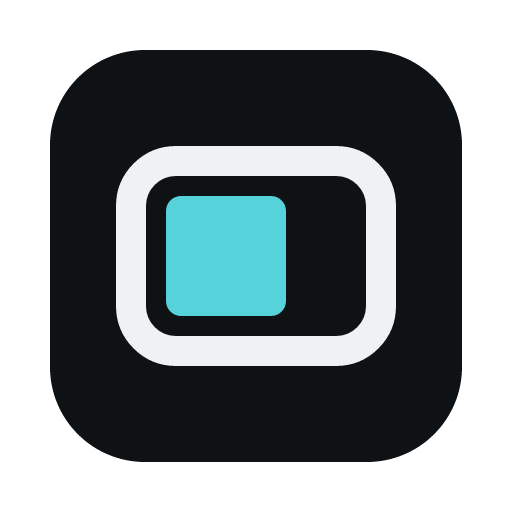

<div align="center">



# Nexora Launcher

A modern, lightweight, open-source launcher for Minecraft: Java Edition.<br>
Built with Rust and Tauri 2.

[](https://github.com/Nek0cha/Nexora-Launcher/actions/workflows/ci.yml)
[](https://github.com/Nek0cha/Nexora-Launcher/releases)
[](LICENSE)

**English** | [日本語](README.ja.md)

</div>

## Features

- **Every loader:** Vanilla, Fabric, Quilt, Forge and NeoForge instances, with the Java runtime installed for you.
- **Mods, resource packs and shaders:** search and install from Modrinth with their dependencies, update them, switch them on and off, and add files by drag and drop.
- **Modpacks:** import and export Modrinth `.mrpack` files.
- **Import from other launchers:** Modrinth App, Prism Launcher, the official launcher and the CurseForge app. Your original data is only read, never changed.
- **Crash diagnosis:** when the game crashes, Nexora points at the suspected mods and disables the ones you pick.
- **Settings sync:** share options between instances.
- **Version upgrade:** move an instance to a newer Minecraft version.
- **Skins, screenshots and logs** for each account and instance.
- **Self-updating**, with no backend server: sign-in happens on your device with your own Microsoft account.

The status of each feature, including what has not yet been tried on a real machine, is in [docs/features.md](docs/features.md).

## Install

Download the file for your system from the [Releases](https://github.com/Nek0cha/Nexora-Launcher/releases) page.

| System | File |
|---|---|
| Windows | `Nexora_<version>_x64-setup.exe` |
| macOS (Apple Silicon) | `Nexora_<version>_aarch64.dmg` |
| macOS (Intel) | `Nexora_<version>_x64.dmg` |
| Linux | `Nexora_<version>_amd64.AppImage` or `Nexora_<version>_amd64.deb` |

The installers are not code-signed, because a signing certificate costs money and Nexora Launcher is a free project. The first launch therefore shows a warning from the operating system:

- **Windows:** SmartScreen shows "Windows protected your PC". Choose "More info", then "Run anyway".
- **macOS:** the app is blocked as coming from an unidentified developer. Open it once, then go to System Settings → Privacy & Security and choose "Open Anyway" next to the message about Nexora. If macOS says the app is damaged, run `xattr -dr com.apple.quarantine /Applications/Nexora.app` in a terminal.
- **Linux:** make the AppImage executable (`chmod +x`) and run it. Only the AppImage updates itself; with the `.deb`, install the new package by hand.

The app checks for a new version when it starts, and shows an update button in the title bar when there is one. Updates are verified with a signing key of the project; nothing is installed until you press the button.

## Build from source

You need Rust (the version in `rust-toolchain.toml` is selected automatically), Node.js 24, pnpm 11, WebView2 on Windows and the [Tauri prerequisites](https://v2.tauri.app/start/prerequisites/) on Linux.

```sh
pnpm install
pnpm dev
```

Microsoft sign-in needs a client ID in the `NEXORA_MS_CLIENT_ID` environment variable at build time. Forks must register their own and pass the [Minecraft API review](https://aka.ms/mce-reviewappid). A development build also offers an offline account, so you can start the game without signing in.

```sh
cargo test --workspace
pnpm --filter ui test --run
pnpm --filter ui typecheck
```

More details (in Japanese) are in [README.ja.md](README.ja.md#開発環境). Design documents are in `docs/specs/`, and the release procedure is in [docs/releasing.md](docs/releasing.md).

## Privacy

There is no backend server. The launcher talks to Microsoft, Xbox and Minecraft services to sign you in, to Modrinth to identify, search and download content (it sends the SHA-1 hashes of your mods, never account data), and to GitHub to check for updates. The details are in [docs/privacy.md](docs/privacy.md).

## License

Apache License 2.0. See [LICENSE](LICENSE); the licenses of the bundled third-party software are shown in the app under Settings → About.

Nexora Launcher is not an official Minecraft product and is not approved by or associated with Mojang or Microsoft.
