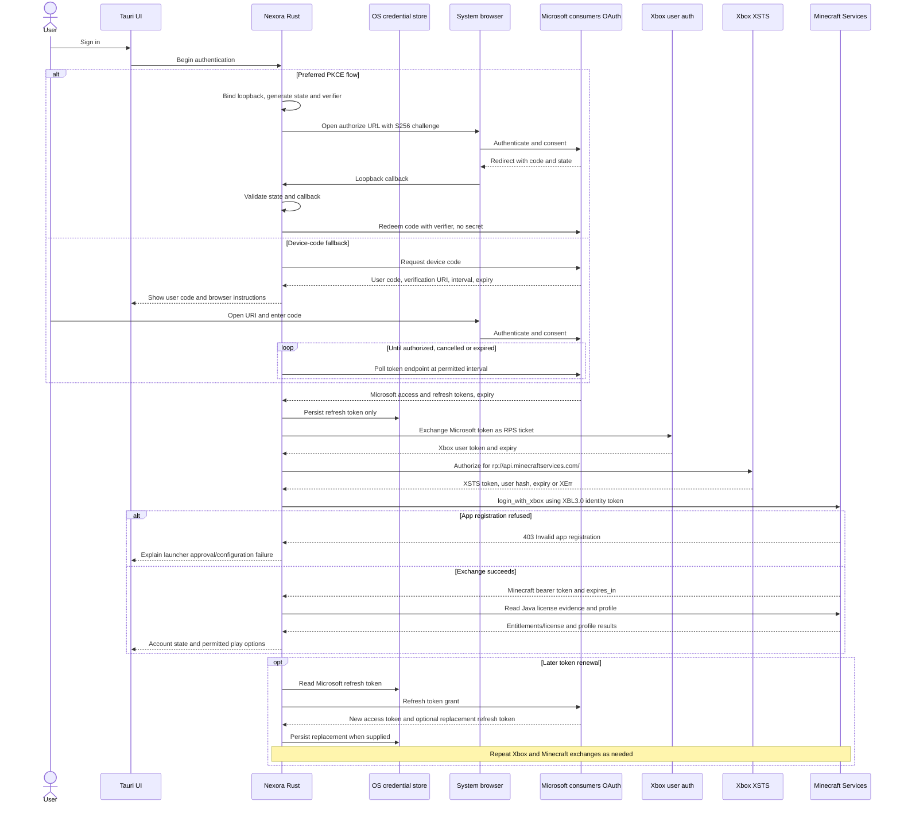

# Microsoft authentication research for Nexora Launcher

Research date: 2026-10-15. Scope: a from-scratch Rust/Tauri 2 public desktop client, Windows first, with macOS/Linux planned and no backend. Apache-2.0 is the planned project license. These are project requirements supplied for this research.

**Evidence labels:** **Documented** means a provider or crate maintainer documents the behavior; **Observed implementation** means a maintained project's source demonstrates it, not that Microsoft guarantees it. **Recommendation/inference** identifies a proposed Nexora decision. **UNVERIFIED** identifies a claim that could not be established from accessible authoritative evidence. No authenticated API calls, Azure registration, or approval submission were performed. Versions below are the versions shown by the retrieved Docs.rs `latest` pages; a direct crates.io registry check was blocked, so an independently confirmed registry snapshot is **UNVERIFIED**.

**Recommended direction:** use authorization code with S256 PKCE in the system browser and a temporary loopback listener. Offer device code as an explicit fallback. Keep authentication and credential access in Rust, persist the Microsoft refresh token in an OS credential store, and obtain Minecraft access through the Xbox token chain. Treat Minecraft application approval as a release prerequisite. These are design recommendations based on the evidence below.

## 1. Azure / Microsoft Entra application registration

### Developer tenant and account audience

**Documented:** the current registration quickstart requires a tenant, an account with registration permissions (at least Application Developer in that guide), and an Azure account with an active subscription. The application object belongs to its registration tenant and cannot be moved between tenants. A personal Microsoft account alone is therefore not a substitute for access to a tenant. [Microsoft registration quickstart](https://learn.microsoft.com/en-us/entra/identity-platform/quickstart-register-app)

**Documented:** Microsoft's tenant-creation guide currently restricts creation of additional Workforce tenants in the admin center to paid customers; free/trial customers are directed to Azure account signup. **Recommendation:** a personal-account developer should first establish access to a suitable Workforce tenant and check registration rights, rather than follow old instructions promising tenant-free registration. The exact signup path, eligibility, and cost for this developer are **UNVERIFIED**. An External ID customer tenant is not a recommended workaround for this Xbox scenario. [Tenant creation prerequisites](https://learn.microsoft.com/en-us/entra/fundamentals/create-new-tenant)

The current registration guide lists four supported audiences: one organizational tenant; any Entra tenant; any Entra tenant plus personal Microsoft accounts; and personal Microsoft accounts only. The last two include Xbox/Live accounts. **Recommendation:** choose **Personal Microsoft accounts only** when available, because Nexora targets consumer Minecraft identities. If the portal requires the broader organizational-plus-personal audience, select it and still use `consumers` at runtime. Single-tenant and organizational-only audiences do not fit this consumer login design. [Supported account types](https://learn.microsoft.com/en-us/entra/identity-platform/quickstart-register-app)

There is a documentation inconsistency: the MSAL configuration page still describes organizational-plus-personal registration combined with `consumers` as the route to personal-only sign-in, whereas the newer registration quickstart explicitly offers personal-only registration. **Recommendation:** record the actual registration audience and test it with the developer's approved client ID. `consumers` denotes personal Microsoft accounts; it is not the developer's tenant GUID. [MSAL audience and authority configuration](https://learn.microsoft.com/en-us/entra/identity-platform/msal-client-application-configuration)

### Concrete registration settings

| Setting | Recommended Nexora configuration and evidence |
| --- | --- |
| Name | Use Nexora Launcher and maintain clear branding; the registered name is visible to users. [Registration guide](https://learn.microsoft.com/en-us/entra/identity-platform/quickstart-register-app) |
| IDs | Record Application/client ID and Directory/tenant ID separately; runtime requests below use the client ID and `consumers` authority. The client ID identifies the registration. [Registration guide](https://learn.microsoft.com/en-us/entra/identity-platform/quickstart-register-app), [authority configuration](https://learn.microsoft.com/en-us/entra/identity-platform/msal-client-application-configuration) |
| Platform | Add **Mobile and desktop applications**, rather than Web or SPA, for the native redirect. [Desktop configuration](https://learn.microsoft.com/en-us/azure/active-directory/develop/scenario-desktop-overview) |
| System-browser redirect | Register `http://localhost`; use `http://localhost:<allocated-port>` in the transaction. Microsoft ignores the port when matching a localhost URI; paths still distinguish registrations. Avoid registering several variants differing only by port. [Redirect matching rules](https://learn.microsoft.com/en-us/entra/identity-platform/reply-url#localhost-exceptions) |
| Native-client redirect | `https://login.microsoftonline.com/common/oauth2/nativeclient` is Microsoft's documented embedded-browser redirect. It is not a callback server owned by Nexora and does not replace a loopback listener for the system-browser design. [Desktop configuration](https://learn.microsoft.com/en-us/azure/active-directory/develop/scenario-desktop-overview) |
| Allow public client flows | Enable **Yes** if shipping device code. Microsoft's identity guidance lists device code among flows requiring this setting. For PKCE alone, configure the native redirect; do not assume the fallback public-client switch is a universal PKCE requirement. [Public-client flow guidance](https://learn.microsoft.com/en-us/entra/identity-platform/msal-client-applications), [desktop configuration](https://learn.microsoft.com/en-us/azure/active-directory/develop/scenario-desktop-overview) |
| Credentials | Do not create or ship a client secret for this desktop flow. Public native clients cannot securely keep an application secret, and Microsoft says not to use one for code redemption. [Authorization-code protocol](https://learn.microsoft.com/en-us/entra/identity-platform/v2-oauth2-auth-code-flow) |

**Documented nuance:** Microsoft recommends the `127.0.0.1` literal to avoid localhost configuration problems, but HTTP literal redirects may require editing the manifest. The same documentation limits its port-ignoring statement to localhost redirects and says IPv6 `[::1]` is unsupported. **Recommendation:** start with the requested, documented `http://localhost:<port>` route, bind only loopback, and test resolver behavior. Do not silently substitute an IP-literal redirect or assume identical port matching without testing the registration. [Loopback exceptions](https://learn.microsoft.com/en-us/entra/identity-platform/reply-url#localhost-exceptions)

### Publisher verification and consent

**Documented:** publisher verification associates a verified Microsoft AI Cloud Partner Program organization/Partner ID with the app. Requirements include a suitable tenant, domain, roles and MFA; the app must have been registered using an Entra work/school account, rather than a personal Microsoft account. A verified publisher receives a blue badge in Entra consent. The badge establishes publisher identity, not a security certification or Minecraft API approval. **Recommendation:** if verification is intended, create/manage the registration through the developer's tenant work account from the start. [Publisher verification requirements](https://learn.microsoft.com/en-us/entra/identity-platform/publisher-verification-overview)

**Documented:** Entra consent identifies the application, publisher and requested permissions; branding can include privacy and terms links. Newly registered multitenant apps without publisher verification show an unverified publisher status; organizational consent policies may require admin approval. Merely setting a publisher domain does not give a new app the verified badge. [Consent experience](https://learn.microsoft.com/en-us/entra/identity-platform/application-consent-experience), [publisher domain display rules](https://learn.microsoft.com/en-us/entra/identity-platform/howto-configure-publisher-domain)

**UNVERIFIED:** the exact wording/layout of the consumer Xbox consent screen for Nexora's future registration, and whether every personal-account user sees the same warning. Do not promise a warning-free consumer flow. Microsoft documents `offline_access` using a consent description about maintaining previously granted access. **Recommendation:** publish clear privacy/terms URLs and capture the actual consumer consent screen during approval testing. [Scope descriptions](https://learn.microsoft.com/en-us/entra/identity-platform/scopes-oidc#the-offline_access-scope)

## 2. OAuth choices and token renewal

### Endpoints and scopes

Use the following v2 endpoints, formed with the documented `consumers` tenant alias. Authorization and device-code requests are alternatives; both use the token endpoint. [Authorization-code protocol](https://learn.microsoft.com/en-us/entra/identity-platform/v2-oauth2-auth-code-flow), [device-code protocol](https://learn.microsoft.com/en-us/entra/identity-platform/v2-oauth2-device-code)

| Purpose | Endpoint |
| --- | --- |
| Browser authorization, GET | `https://login.microsoftonline.com/consumers/oauth2/v2.0/authorize` |
| Code exchange, device polling, refresh, POST | `https://login.microsoftonline.com/consumers/oauth2/v2.0/token` |
| Device authorization, POST | `https://login.microsoftonline.com/consumers/oauth2/v2.0/devicecode` |

**Recommended requested scopes:** `XboxLive.signin offline_access`. The Xbox scope spelling and consumer authority are demonstrated in a first-person authentication implementation; Microsoft documents that v2 requests must explicitly include `offline_access` to receive refresh tokens. **UNVERIFIED:** a current public Microsoft Xbox specification guaranteeing that short scope spelling for every newly approved registration. Verify it with Nexora's ID. Avoid adding Graph `User.Read` or OIDC identity scopes unless Nexora needs them. [Authentication implementation](https://gist.github.com/janispritzkau/bf7006a858caa44afd47fc210be3c716), [Microsoft scope documentation](https://learn.microsoft.com/en-us/entra/identity-platform/scopes-oidc#the-offline_access-scope)

### Authorization code + S256 PKCE

**Documented:** request `response_type=code`, the registered `redirect_uri`, scopes, random `state`, `code_challenge` and `code_challenge_method=S256`. Redeem the returned code with `grant_type=authorization_code`, client ID, the same redirect URI and `code_verifier`, using form encoding. Validate returned state before exchanging the code. [Microsoft authorization-code protocol](https://learn.microsoft.com/en-us/entra/identity-platform/v2-oauth2-auth-code-flow)

**Recommendation:** Rust should generate and retain the verifier/state, bind an available loopback port before opening the browser, handle one valid callback with a bounded timeout, and close the listener afterward. Reject unexpected paths, malformed/repeated parameters and state mismatches. Never bind a wildcard LAN address. Keep callback URLs, authorization codes and tokens out of logs; return a small static completion page without third-party assets. These choices apply native-app OAuth's PKCE and loopback guidance. [RFC 8252, sections 7.3 and 8](https://www.rfc-editor.org/rfc/rfc8252)

### Device code

**Documented:** POST form fields `client_id` and `scope` to `/devicecode`. Display the returned `user_code` and `verification_uri`; poll `/token` using `grant_type=urn:ietf:params:oauth:grant-type:device_code`, the client ID and private `device_code`. Respect returned `interval` and `expires_in`; Microsoft's default authorization window is 15 minutes. Handle `authorization_pending`, `authorization_declined`, `bad_verification_code` and `expired_token`. Microsoft currently does not return `verification_uri_complete`. [Device-code protocol](https://learn.microsoft.com/en-us/entra/identity-platform/v2-oauth2-device-code)

**Recommendation:** provide cancellation, expiry countdown and backoff, including `slow_down` if returned under the device grant standard. Start only on a local user action, never accept a code supplied by another person, and never expose the private device code. The standard defines polling slowdown behavior. [RFC 8628](https://www.rfc-editor.org/rfc/rfc8628)

| Option | Evaluation for Nexora — recommendation/inference |
| --- | --- |
| System-browser PKCE | Preferred desktop experience: recognizable Microsoft origin, browser session reuse and automatic callback. Requires robust port allocation, callback validation and cancellation. Microsoft describes browser SSO and localhost listeners. [Browser guidance](https://learn.microsoft.com/en-us/entra/msal/dotnet/acquiring-tokens/using-web-browsers) |
| Device code | Useful when a loopback callback cannot complete or the user wants to authenticate on another device. Adds code entry, polling and phishing-sensitive UX, but needs no redirect listener. [Device protocol](https://learn.microsoft.com/en-us/entra/identity-platform/v2-oauth2-device-code), [device grant security considerations](https://www.rfc-editor.org/rfc/rfc8628) |
| Embedded Tauri webview | Keep the launcher UI there, but send Microsoft authentication to the external browser. An app-controlled webview shares a security boundary with the app and complicates trusted-origin/SSO expectations. [Native-app OAuth guidance](https://www.rfc-editor.org/rfc/rfc8252#section-8.12) |

**Microsoft policy nuance:** there is no verified blanket Microsoft ban on every embedded webview. MSAL.NET explicitly documents embedded and system-browser options and generally recommends platform defaults, typically the system browser. Its WebView2 guidance also documents authority-specific support limitations. Those MSAL.NET statements are not a Tauri support guarantee. **UNVERIFIED:** a policy specifically approving arbitrary Tauri webviews for consumer Xbox login. The external-browser choice follows RFC 8252 rather than asserting a Microsoft-wide prohibition. [Microsoft browser options](https://learn.microsoft.com/en-us/entra/msal/dotnet/acquiring-tokens/using-web-browsers), [WebView2 limitations](https://learn.microsoft.com/en-us/entra/msal/dotnet/advanced/webview2), [RFC 8252](https://www.rfc-editor.org/rfc/rfc8252)

### Refresh and lifetime rules

**Documented:** refresh through the same token endpoint with form fields `grant_type=refresh_token`, client ID and refresh token; use the granted scope set when supplying scopes. Microsoft access-token responses include `expires_in`; use that instead of a fixed timer. [Refresh request protocol](https://learn.microsoft.com/en-us/entra/identity-platform/v2-oauth2-auth-code-flow#refresh-the-access-token)

**Documented:** Microsoft's general default refresh-token lifetime is 90 days outside SPA/email-one-time-passcode scenarios; SPA tokens default to 24 hours. A refresh normally yields a new refresh token, but use of the previous token does not itself revoke it. Revocation can happen before expiry. These defaults are not a promise that a consumer Xbox account will remain signed in for 90 days. [Refresh-token lifetimes and revocation](https://learn.microsoft.com/en-us/entra/identity-platform/refresh-tokens)

**Recommendation:** serialize refreshes per account, persist a returned replacement before discarding the old value, and retain the previous value if no replacement is returned. Refresh slightly before expiry with clock-skew allowance. On `invalid_grant` or required interaction, request interactive sign-in rather than loop forever. Differentiate network failure from explicit revocation; deleting credentials during a temporary outage would needlessly lose the session. Do not parse Microsoft access tokens as if they were JWTs belonging to Nexora; Microsoft warns they may be opaque or encrypted. [Token handling warning](https://learn.microsoft.com/en-us/entra/identity-platform/v2-oauth2-device-code#successful-authentication-response)

## 3. Xbox Live user token and XSTS

The following exchange is **Observed implementation**, not an authenticated test or complete provider contract. The inspected Xbox implementation uses RPS tickets and response `Token`, `DisplayClaims.xui` and `NotAfter` fields. It also supports additional title/device/proof mechanisms outside Nexora's proposed simple public-client flow. **UNVERIFIED:** whether an approved Nexora registration needs any additional Xbox headers or proof mechanisms; confirm during integration. [Xbox token manager](https://github.com/PrismarineJS/prismarine-auth/blob/master/src/TokenManagers/XboxTokenManager.js)

1. POST JSON to `https://user.auth.xboxlive.com/user/authenticate`: set `Properties.AuthMethod` to `RPS`, `Properties.SiteName` to `user.auth.xboxlive.com`, and `Properties.RpsTicket` to `d=<Microsoft access token>` for the Azure/v2 route. Set `RelyingParty` to `http://auth.xboxlive.com` and `TokenType` to `JWT`. Extract the Xbox user token. [RPS exchange implementation](https://github.com/PrismarineJS/prismarine-auth/blob/master/src/TokenManagers/XboxTokenManager.js)
2. POST JSON to `https://xsts.auth.xboxlive.com/xsts/authorize`: set `Properties.SandboxId` to `RETAIL`, `Properties.UserTokens` to an array containing that user token, `RelyingParty` to **`rp://api.minecraftservices.com/`**, and `TokenType` to `JWT`. Read the XSTS token and its `DisplayClaims.xui[0].uhs` user hash. [Xbox exchange implementation](https://github.com/PrismarineJS/prismarine-auth/blob/master/src/TokenManagers/XboxTokenManager.js), [Minecraft relying-party constant](https://github.com/PrismarineJS/prismarine-auth/blob/master/src/common/Constants.js)

**Recommendation:** retain each returned expiry independently and do not substitute an Xbox-services or Bedrock XSTS token for the Minecraft Java audience. Use the hash from the XSTS response to construct the Minecraft identity token. Do not treat the Xbox hash as the Minecraft profile UUID.

### Known XErr values and proposed messages

These mappings are **Observed implementation** in PrismarineJS's error table. They are **UNVERIFIED as a complete/current Microsoft error contract**, particularly the precise distinction between age-related codes. The action column is Nexora's proposed wording, not Microsoft text. [Maintainer's XErr table](https://github.com/PrismarineJS/prismarine-auth/blob/master/src/common/Constants.js)

| XErr | Reported meaning | Proposed user guidance |
| --- | --- | --- |
| `2148916227` | Xbox account banned | Explain the restriction; direct the user to Xbox account/support review. |
| `2148916229` | Guardian has restricted online access | Ask the family organizer to review Xbox permissions. |
| `2148916233` | No Xbox profile | Ask the user to sign in on Xbox's website and complete profile creation. |
| `2148916234` | Xbox terms not accepted | Ask the user to complete Xbox sign-in and accept required terms. |
| `2148916235` | Region unavailable | Explain Xbox service availability for the account's region. |
| `2148916236` | Age proof required | Direct the user through Microsoft's age-verification process. |
| `2148916237` | Playtime limit reached | Explain that an account playtime restriction needs review. |
| `2148916238` | Child account requires an adult-managed family | Ask a parent/guardian to complete family setup and permissions. |

**Recommendation:** preserve numeric XErr and a safe correlation identifier in diagnostics; handle an unknown code without inventing a cause. Do not suggest false birth dates, region circumvention, or repeated retries for policy failures. Open remediation links only from an application-maintained allowlist rather than blindly following a server-provided redirect.

## 4. Minecraft Services, entitlement and app approval

### Exchange and read-only account checks

**Observed implementation:** all endpoint requests below use HTTPS. The Xbox login submits JSON; subsequent reads use `Authorization: Bearer <Minecraft access token>`, not the Microsoft or Xbox token. [Minecraft token manager](https://github.com/PrismarineJS/prismarine-auth/blob/master/src/TokenManagers/MinecraftJavaTokenManager.js), [endpoint constants](https://github.com/PrismarineJS/prismarine-auth/blob/master/src/common/Constants.js)

| Request | Purpose / response evidence |
| --- | --- |
| POST `https://api.minecraftservices.com/authentication/login_with_xbox` | JSON `identityToken` value is `XBL3.0 x=<XSTS user hash>;<XSTS token>`. The returned access token is cached using `expires_in` in the inspected implementation. [Exchange and expiry handling](https://github.com/PrismarineJS/prismarine-auth/blob/master/src/TokenManagers/MinecraftJavaTokenManager.js) |
| GET `https://api.minecraftservices.com/entitlements/mcstore` | Older store-entitlement route; observed types contain `items` with entitlement names/signatures, plus response signature/key ID. [Maintainer's response types](https://github.com/PrismarineJS/prismarine-auth/blob/master/index.d.ts) |
| GET `https://api.minecraftservices.com/entitlements/license?requestId=<random-UUID>` | Newer license route exists in the endpoint constants and response types. The maintainer describes it as including Game Pass access; items have `name` and `source`, with optional response errors. **UNVERIFIED:** provider-supported stability and exhaustive item/source semantics. [Endpoint constants](https://github.com/PrismarineJS/prismarine-auth/blob/master/src/common/Constants.js), [license response types](https://github.com/PrismarineJS/prismarine-auth/blob/master/index.d.ts) |
| GET `https://api.minecraftservices.com/minecraft/profile` | Reads Java profile ID, name, skins and capes. [Profile request](https://github.com/PrismarineJS/prismarine-auth/blob/master/src/TokenManagers/MinecraftJavaTokenManager.js), [response types](https://github.com/PrismarineJS/prismarine-auth/blob/master/index.d.ts) |

**UNVERIFIED:** there is no confirmed provider promise here that `/entitlements/license` has replaced or deprecated `/entitlements/mcstore`. The inspected manager still fetches `mcstore` while declaring the newer license endpoint separately. Similarly, do not hard-code Minecraft's token lifetime: examples elsewhere often use 86,400 seconds, but a current guaranteed 24-hour lifetime was not established. Use returned `expires_in`; no separate Minecraft refresh-token mechanism was verified. **Recommendation:** renew the Microsoft token, then repeat Xbox/XSTS/Minecraft exchange when necessary. [Observed Minecraft expiry logic](https://github.com/PrismarineJS/prismarine-auth/blob/master/src/TokenManagers/MinecraftJavaTokenManager.js)

### Game Pass and failure classification

**Documented:** Minecraft Java was included with the PC Game Pass bundle; subscription access must be considered alongside a purchase. Current plan/region eligibility for a particular user remains **UNVERIFIED** until checked against that user's subscription. [Mojang's Game Pass announcement](https://www.minecraft.net/en-us/article/minecraft-now-included-game-pass-pc-)

**Recommendation/inference:** query the newer license route during integration testing and use fresh Java access evidence together with the Java profile. An empty `mcstore` response alone should not produce a final “buy Minecraft” message for a possible subscriber. Do not accept any nonempty item list as Java entitlement: Bedrock or trial access must not be mistaken for full Java access. The license response's `source` can help diagnostics, but its exhaustive values and expiry semantics are **UNVERIFIED**. [License response evidence](https://github.com/PrismarineJS/prismarine-auth/blob/master/index.d.ts)

**UNVERIFIED:** exact current behavior for a newly subscribed Game Pass user who has not initialized a Java profile, including whether the official launcher must be used once. **Recommendation:** offer to open the official account/profile setup when entitlement exists but the Java profile is absent; do not create a profile or choose a username without user intent. Also test subscription expiry, renewal, subscription-to-purchase transition, account mismatch, and expired subscription with an existing profile. A cached profile should not be treated as a permanent entitlement.

Proposed error handling, pending integration verification:

- **401:** renew the token once, then require sign-in if authorization still fails.
- **403 with `Invalid app registration`:** show a launcher/developer configuration problem, distinct from lack of ownership. Do not make the user buy the game again.
- **403 with another body:** preserve the distinction; do not classify all 403s as registration failures.
- **Profile 404:** show “Java profile unavailable; account setup may be required,” rather than immediately declaring no license. The exact response contract is **UNVERIFIED**.
- **429, 5xx, timeout, or partial license errors:** show a temporary/unresolved check, with bounded retry. Never turn an unavailable service into a successful entitlement check or a definitive ownership denial.

### Minecraft application approval

**Observed developer report:** an application completing Microsoft/Xbox authentication can be refused by Minecraft Services with HTTP 403 and `Invalid app registration`; the reporting developer identifies a third-party launcher and asks about access approval. This is primary evidence of a reported failure, not an independently reproduced Nexora response. **UNVERIFIED:** the complete current allowlisting policy, timelines and appeal process. Do not treat automated/community answers on Microsoft Q&A as an official approval contract. [First-person Microsoft Q&A report](https://learn.microsoft.com/en-in/answers/questions/5984225/minecraft-services-http-403-invalid-app-registrati)

**Observed link behavior:** opening [the Minecraft app review short link](https://aka.ms/mce-reviewappid) redirected to [Microsoft Forms](https://forms.office.com/Pages/ResponsePage.aspx?id=v4j5cvGGr0GRqy180BHbR-ajEQ1td1ROpz00KtS8Gd5UNVpPTkVLNFVROVQxNkdRMEtXVjNQQjdXVC4u); the research tool could not retrieve the form body. Its live questions, submission availability and requirements are **UNVERIFIED**. The related [app-registration information short link](https://aka.ms/AppRegInfo) also could not be retrieved.

**Preparation checklist, not a verified transcription of the form:** have the Azure client ID, registration tenant ID, developer/contact details, app name, public website/source repository, privacy policy, a description of the desktop authentication flow, distribution plans, and an explanation of entitlement/offline behavior ready. **UNVERIFIED:** which of these are mandatory current fields. Obtain the actual requirements from the live form and retain the approval correspondence. Do not assume Entra publisher verification or Xbox authentication success grants Minecraft API access, and do not borrow another launcher's client ID.

## 5. Secure storage and Rust keyring evaluation

### What Nexora should persist

**Recommendation:** persist only the Microsoft refresh token as the default secret, keyed by a Nexora-specific service identifier and stable local account ID. Keep Microsoft access, Xbox user, XSTS and Minecraft access tokens in Rust memory with separate expiration metadata. Store profile name/UUID and last verified access time separately as non-secret, privacy-sensitive cache metadata. Do not store passwords, PKCE verifiers after the transaction, browser cookies, or complete authentication response blobs.

The alternative is storing all tokens for a faster warm start. **Inference:** that increases disk-resident bearer material, migration complexity and entry-size pressure while still requiring expiry/revocation handling. It is not necessary for the proposed default. The refresh token itself is valuable account access material and must be protected. [Microsoft refresh-token security guidance](https://learn.microsoft.com/en-us/entra/identity-platform/refresh-tokens)

**Recommendation:** serialize refresh and credential updates per account, keep secrets out of JavaScript IPC and localStorage, redact logs/crash reports, and remove local secrets on logout. Explain that local deletion is distinct from server-side token revocation; previously issued tokens may remain usable until expiry/revocation. [Microsoft revocation behavior](https://learn.microsoft.com/en-us/entra/identity-platform/refresh-tokens)

### Platform stores and failure modes

| Platform | Evidence and proposed handling |
| --- | --- |
| Windows | **Verified documented limit: 2,560 bytes = 5 × 512 = 2.5 KiB** per credential blob, not 2,560 Unicode characters. Both Microsoft Learn and Microsoft's published SDK header give this value. Generic credentials have application-defined blob contents. [CREDENTIALW](https://learn.microsoft.com/en-us/windows/win32/api/wincred/ns-wincred-credentialw), [Microsoft SDK header](https://github.com/microsoft/win32metadata/blob/main/generation/WinSDK/RecompiledIdlHeaders/um/wincred.h) |
| Windows crate behavior | The native backend maps entries to generic credentials and defaults to Enterprise persistence; it allows Local persistence and warns about concurrent operations on one credential. **Recommendation:** explicitly choose Local persistence, collision-resistant names and per-account serialization. [Backend documentation](https://docs.rs/windows-native-keyring-store/1.1.0/windows_native_keyring_store/) |
| macOS | The Apple backend distinguishes traditional Keychain Services from protected-data storage, with feature/sandbox/provisioning differences. **Recommendation:** use its `keychain` backend for an ordinary desktop distribution and verify signed-app access/update prompts. Sandboxed distribution needs a separate protected-store assessment. [Apple backend](https://docs.rs/apple-native-keyring-store/1.0.2/apple_native_keyring_store/) |
| Linux | Secret Service requires a functioning user session/service and accessible collection; it is not guaranteed on headless/minimal systems. Backend docs call out headless, WSL-default-collection and KDE Wallet caveats. **Recommendation:** detect unavailable/locked storage and offer session-only login; let the user unlock/configure their store. [Secret Service backend caveats](https://docs.rs/zbus-secret-service-keyring-store/1.0.1/zbus_secret_service_keyring_store/) |

**Recommendation:** measure the actual bytes written by the selected Windows API, including any string encoding or wrapper overhead. A refresh token alone is not guaranteed to fit: a documented maximum token length was not established (**UNVERIFIED**). Test realistic long tokens and storage errors. Never truncate a token. Initially prefer session-only sign-in if it cannot be stored. A future encrypted-file vault may keep a small random encryption key in the OS store and the authenticated ciphertext on disk; that requires a separate reviewed design. Do not silently fall back to plaintext or place the encryption key beside the ciphertext.

**Documented:** Linux kernel keyutils is another backend, but its session/persistent-keyring lifecycle differs from a desktop vault and should not be assumed to provide indefinite disk persistence. The `keyring-core` mock/sample stores explicitly carry no secure/robust storage guarantee. **Recommendation:** neither is a silent persistent-login fallback. [Keyutils lifecycle](https://docs.rs/linux-keyutils-keyring-store/latest/linux_keyutils_keyring_store/), [core store warning](https://docs.rs/keyring-core/1.0.1/keyring_core/)

### Current `keyring` architecture

**Documented version observed: `keyring` 4.2.0.** Its default `v1` compatibility interface automatically selects Windows Credential Manager, macOS Keychain Services and Secret Service on Unix. Its `cli` mode is demonstration/integration glue; maintainers advise applications needing explicit backend control to use `keyring-core` plus selected backend crates. Old `keyring` 3.x feature examples should not be copied into a 4.x dependency declaration. [Current crate](https://docs.rs/keyring/4.2.0/keyring/), [v1 backend selection](https://docs.rs/keyring/4.2.0/keyring/v1/index.html)

**Recommendation:** use `keyring-core` with target-specific native stores for Nexora, allowing deliberate Windows persistence, consistent error handling and an explicit Linux fallback policy. For the zbus Secret Service backend, select exactly one documented runtime/crypto feature combination; KDE may require UTF-8 encoding for binary secrets. Store calls that may block or prompt should run off the UI thread. Do not assume that a thread-safe Rust API makes simultaneous operations on one underlying credential reliable. [zbus backend features](https://docs.rs/zbus-secret-service-keyring-store/1.0.1/zbus_secret_service_keyring_store/), [core concurrency warning](https://docs.rs/keyring-core/1.0.1/keyring_core/)

## 6. Offline accounts and demo policy

**Documented:** Mojang's EULA grants play/download rights when buying the game, restricts redistribution, requires authorized download sources, and says third-party tools should not appear official. **UNVERIFIED:** a currently accessible Mojang policy specifically stating the precise rules for offline identities in third-party launchers. The reviewed EULA and Usage Guidelines do not establish a launcher's exact required cache duration or a universal “one purchased account unlocks arbitrary offline accounts” rule. [Minecraft EULA](https://www.minecraft.net/en-us/eula), [Minecraft Usage Guidelines](https://www.minecraft.net/en-us/usage-guidelines)

**Proposed Nexora policy, pending confirmation during app review:**

- Allow an explicitly labeled offline session only for a previously authenticated Java account with previously verified access and installed game files. Keep it associated with that identity; do not offer unrestricted new username-only accounts as a route to full play.
- Distinguish a temporary network outage from explicit license loss/revocation. Do not convert an expired Game Pass entitlement into indefinite offline authorization. The appropriate offline grace period and subscription-specific rules are **UNVERIFIED** and should be resolved in review before shipping.
- Label online features unavailable during offline play and avoid presenting an offline identity as a valid online authenticated session.
- Offer a clearly labeled demo option or link to the official trial for users without verified access; never remove demo restrictions or imply a full license.

**Documented:** Mojang offers an official Java trial on Windows, macOS and Linux, lasting approximately 100 minutes/five in-game days; the trial FAQ describes offline play and online-multiplayer restrictions. This does not by itself document permission or the launch contract for a third-party demo implementation. **UNVERIFIED:** a current provider-approved third-party demo argument/session recipe. **Recommendation:** link to the official trial initially, or validate a genuine restricted demo launch as part of approval. [Official trial and FAQ](https://www.minecraft.net/en-us/free-trial)

## 7. Rust crate candidates

Versions below were displayed by maintainer-generated Docs.rs documentation during this research. They are candidates, not a tested dependency set; exact resolution, target builds, MSRV and transitive license compatibility remain implementation checks.

| Crate | Version observed | Role / evaluation |
| --- | --- | --- |
| `oauth2` | **5.0.0** | Typed OAuth client with PKCE, refresh and device authorization support. Preferred protocol helper; it does not replace the Xbox/Minecraft exchange. [Docs](https://docs.rs/oauth2/5.0.0/oauth2/) |
| `reqwest` | **0.13.5** | Async HTTP, form/JSON requests and configurable redirects/TLS. Candidate for Xbox/Minecraft traffic. [Docs](https://docs.rs/reqwest/0.13.5/reqwest/) |
| `keyring` | **4.2.0** | Simple cross-platform wrapper; use `v1` only if automatic backend choices meet requirements. [Docs](https://docs.rs/keyring/4.2.0/keyring/) |
| `keyring-core` | **1.0.1** | Explicit credential-store abstraction; preferred for controlled platform selection. [Docs](https://docs.rs/keyring-core/1.0.1/keyring_core/) |
| `windows-native-keyring-store` | **1.1.0** | Windows Credential Manager integration and persistence selection. [Docs](https://docs.rs/windows-native-keyring-store/1.1.0/windows_native_keyring_store/) |
| `apple-native-keyring-store` | **1.0.2** | macOS Keychain/protected-store alternatives. [Docs](https://docs.rs/apple-native-keyring-store/1.0.2/apple_native_keyring_store/) |
| `zbus-secret-service-keyring-store` | **1.0.1** | Linux Secret Service candidate; choose runtime/crypto features deliberately. [Docs](https://docs.rs/zbus-secret-service-keyring-store/1.0.1/zbus_secret_service_keyring_store/) |
| `tauri-plugin-opener` | **2.7.2** | Opens the authorization URL in the user's browser. Constrain allowable URLs/commands in Nexora. [Docs](https://docs.rs/tauri-plugin-opener/2.7.2/tauri_plugin_opener/) |
| `secrecy` | **0.10.3** | Explicit secret exposure and accidental-debug-leak protection; not locked-memory isolation. [Docs](https://docs.rs/secrecy/0.10.3/secrecy/) |
| `zeroize` | **1.9.1** | Clears supported secret buffers without compiler removal; requires Rust 1.85 in this version. It cannot erase every copy made elsewhere. [Docs and limitations](https://docs.rs/zeroize/1.9.1/zeroize/) |

**Compatibility finding:** `oauth2` 5.0.0's built-in reqwest dependency is **0.12**, so a 0.13 `reqwest::Client` is not automatically the same transport type. **Recommendation:** use the supported 0.12 integration, accept two versions intentionally, or implement the crate's HTTP-client abstraction for the chosen transport. Confirm the resolved dependency graph before choosing. Disable token-endpoint redirects as the OAuth crate recommends against SSRF. [Published OAuth manifest](https://docs.rs/crate/oauth2/5.0.0/source/Cargo.toml), [OAuth transport/security documentation](https://docs.rs/oauth2/5.0.0/oauth2/)

**Licensing approach:** this document contains original prose and protocol descriptions, not launcher implementation code. The inspected PrismarineJS authentication project is distinct from Prism Launcher and publishes an MIT license. `oauth2` declares MIT OR Apache-2.0. No GPL launcher code was copied. **Recommendation:** implement from the protocol descriptions, retain provenance, and check every selected crate/transitive license before an Apache-2.0 release; this research is not a completed dependency license audit. [PrismarineJS license](https://github.com/PrismarineJS/prismarine-auth/blob/master/LICENSE), [OAuth package license metadata](https://docs.rs/crate/oauth2/5.0.0/source/Cargo.toml)

## Sequence diagram

This diagram summarizes the proposed orchestration, not an additional verified API contract. OAuth steps follow [Microsoft's code flow](https://learn.microsoft.com/en-us/entra/identity-platform/v2-oauth2-auth-code-flow) and [device flow](https://learn.microsoft.com/en-us/entra/identity-platform/v2-oauth2-device-code); Xbox/Minecraft steps reflect the [observed Xbox implementation](https://github.com/PrismarineJS/prismarine-auth/blob/master/src/TokenManagers/XboxTokenManager.js), [Minecraft exchange](https://github.com/PrismarineJS/prismarine-auth/blob/master/src/TokenManagers/MinecraftJavaTokenManager.js) and [license types](https://github.com/PrismarineJS/prismarine-auth/blob/master/index.d.ts).

## Implementation checklist

The following items are proposed engineering/release acceptance criteria, not claims that implementation or approval already exists.

- [ ] Establish developer tenant access and registration rights; record client ID, tenant ID and chosen account audience.
- [ ] Configure a native desktop redirect and `consumers` authority; enable public-client fallback for device code if offered.
- [ ] Confirm `XboxLive.signin offline_access` with Nexora's own registration; omit client secrets and unnecessary Graph permissions.
- [ ] Complete branding, privacy/terms links and publisher-verification assessment; inspect real consumer consent screens.
- [ ] Inspect the live Minecraft review form, submit accurate application details and obtain approval for the distributed client ID.
- [ ] Resolve remaining **UNVERIFIED** approval, offline/demo and Game Pass policy questions before release.
- [ ] Keep auth network/storage work in Rust; expose only progress and account status to the UI.
- [ ] Implement system-browser S256 PKCE with random state, one-shot loopback callback, bounded parsing, timeout and cancellation.
- [ ] Test port collisions, IPv4/IPv6 localhost resolution, duplicate callbacks, state mismatch and browser abandonment.
- [ ] Implement optional device-code polling with interval/backoff, denial, expiry, cancellation and anti-phishing guidance.
- [ ] Confirm Xbox RPS/XSTS request contracts with the approved ID; preserve stage-specific errors and unknown XErr values.
- [ ] Exchange for the Java Minecraft audience; track each token's returned expiry and refresh per account without races.
- [ ] Validate `/entitlements/license` and legacy `mcstore` behavior with purchased Java, Game Pass, trial, Bedrock-only and unentitled accounts.
- [ ] Test missing Java profile, child/family/region restrictions, expired subscriptions, renewals and account mismatch.
- [ ] Distinguish registration refusal, revoked credentials, unavailable entitlement services and definitive access denial.
- [ ] Choose explicit OS credential backends; verify byte limits, oversized tokens, locked/missing vaults, atomic replacement and logout deletion.
- [ ] Test Windows Local persistence, signed macOS Keychain behavior and Linux GNOME/KDE/minimal-desktop failure handling.
- [ ] Offer session-only login when secure persistence fails; prohibit silent plaintext fallback and secret-bearing logs/IPC.
- [ ] Resolve OAuth/reqwest version compatibility, target features/MSRV and full dependency licenses before pinning dependencies.
- [ ] Review the Mermaid flow against the implemented state machine and recheck live service documentation before release.
